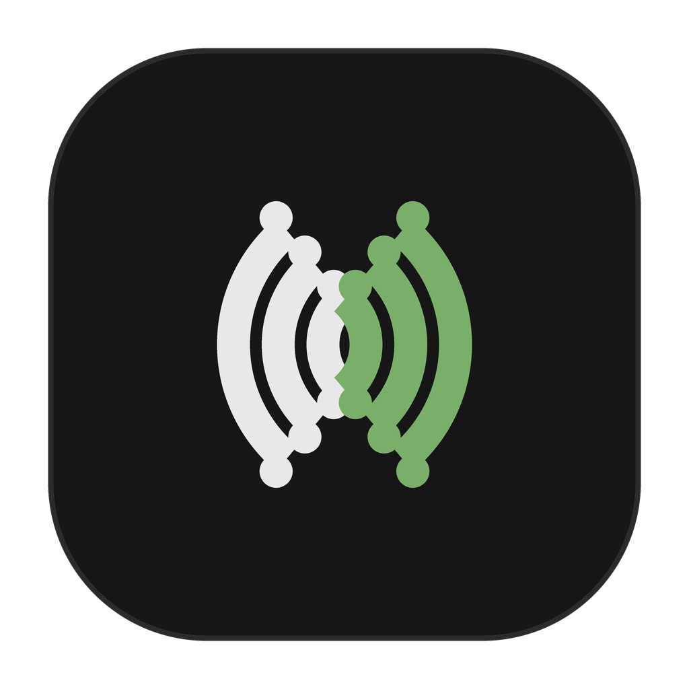

<div align="center">



# Ahenk

**Live-translate whatever is playing on your PC**

System audio · Microphone · Single-app audio → **text + spoken translation**

[Türkçe](README.md) · **[English](#ahenk)**

[](meta.py)
[](https://www.python.org/downloads/)
[](#requirements)
[](LICENSE)
[](tests/)

</div>

> **In short:** Ahenk listens to the selected audio source, streams it to a [Gemini Live Translate](https://ai.google.dev/) session, and returns the translation as both **written transcript** and **spoken audio**. Movies, meetings, lectures, streams — a foreign language comes out of your speakers in Turkish (or your chosen language).

---

## Contents

- [Highlights](#highlights)
- [Features](#features)
- [How it works](#how-it-works)
- [Tech card](#tech-card)
- [Requirements](#requirements)
- [Setup](#setup)
- [Desktop UI](#desktop-ui)
- [Console (CLI)](#console-cli)
- [Languages](#languages)
- [API key](#api-key)
- [Local settings & files](#local-settings--files)
- [Privacy & security](#privacy--security)
- [Layout](#layout)
- [Onefile build](#onefile-build)
- [Automatic updates](#automatic-updates)
- [Tests](#tests)
- [Troubleshooting](#troubleshooting)
- [License](#license)

---

## ✨ Highlights

| | |
|---|---|
| 🎧 **3 input sources** | System audio (WASAPI loopback), microphone, or a single desktop app's audio (process-tree capture with friendly `FileDescription` names and 16×16 icons) |
| 🔄 **Seamless hot-swap** | Switch input/output devices without killing the running translation session |
| 📺 **Subtitle overlay** | Always-on-top, draggable, opacity (`20%–100%`) and font-size adjustable, optionally click-through live subtitle window |
| ⌨️ **Global shortcuts & Push-to-Talk** | Mute/unmute audio, start/stop, and **pause/resume** (`Ctrl+Space`) while in the background + Push-to-Talk mode |
| 🌗 **Dual theme + dual UI language** | Dark / light theme; Turkish / English interface |
| 📝 **Export & search** | Save transcripts as **TXT**, **SRT**, **Bilingual SRT** (`.bilingual.srt`), **WebVTT** (`.vtt`), and **JSONL**; in-pane **`Ctrl+F` search** and smart auto-scroll lock |
| 🔇 **Dynamic dubbing & echo guard** | Automatically attenuates the source app/endpoint while translation speaks (ducking) and injects equal-duration silence on shared speakers |
| 🔁 **Smart reconnect** | Automatic reconnection on transient network/API drops in both GUI and CLI (`reconnect.py`); no pointless retries on permanent key/quota errors |
| 📦 **Single-file distribution** | Installer-free `Ahenk.exe` + zero-Tkinter console `Ahenk-cli.exe`; SHA-256-verified auto-updates |

---

## 🚀 Features

### Audio capture & playback

- **System audio (loopback):** everything playing on the PC via the default speaker's `[Sistem]` (System) record
- **Microphone:** automatic sample-rate and channel fallback (`48000 → 44100 → 32000 → 24000 → 16000 Hz`, stereo → mono) for `[Mikrofon]` inputs
- **Single app:** **Choose desktop app…** lists static PE `FileDescription` names and 16×16 app icons and captures only that program + its child processes (Windows build 20348+)
- **Dynamic dubbing (Audio Ducking):** automatically mutes or ducks source audio only while translation speech plays
- **Output:** speaker selection or **Hiçbiri** (None = text-only mode)
- **Live VU meter:** an independent preview monitor feeds levels from the selected input even before the session starts
- **Audio controls:** fixed 100% translation gain in the GUI; `--volume` and silence gate (`--vad`, e.g. `0.01`) in the CLI

### Translation experience

- **Source language:** `Otomatik` (Auto — detected by the model) or a fixed BCP-47 code
- **Target language:** 20 languages (table below)
- **Live Pause / Resume & Push-to-Talk:** pause/resume audio sending without closing the session (`Ctrl+P` / global hotkey) or use Push-to-Talk mode
- **Custom Glossary:** define terminology hints in two-tab Settings or via `--glossary` for proper names and domain terms
- **Two panes:** **Duyulan** (Heard) and **Çeviri** (Translation) — scrolling up locks auto-scroll with a **Jump to live** pill, and **`Ctrl+F`** searches both live panes and session history
- Per-pane **Copy**, **Clear**, **Export** (`TXT`, `SRT`, `Bilingual SRT`, `WebVTT`, `JSONL`) with disk-spilled full-session export on long runs
- Arrow button swaps source ↔ target (disabled while source is Auto)
- Latency reporting: speech→translation time (ms) on the first translated chunk

### Interface & comfort

- 960×580 dark/light modular window: left control rail + bounded transcript panes + bottom status strip
- Status dot: Ready / Connecting / Running / Paused / Stopped
- **Subtitle window:** last translation line, adjustable font size and opacity (`20%–100%` / `Ctrl+Scroll`), click-through mode, ✕ to close
- **Two-tab Settings & Conversation History:** *General* and *Audio, Glossary & History* tabs, off-thread history persistence + searchable viewer (`history.jsonl`, auto-rotated at 2 MB)
- Turkish / English UI language; window and overlay geometry are remembered
- **Yenile** (Refresh) for the device list, localized guidance for connection and device errors
- Rotating file log (`logs/ahenk.log`)

---

## ⚙️ How it works

```
Input device ── 48→16 kHz auto-rate, 20 ms ────► mono + 16 kHz PCM16 (3:1/2:1 FIR)
                                                        │
                                                        ▼
                                          Gemini Live (v1beta)
                               models/gemini-3.5-live-translate-preview
                                                        │
                    ┌───────────────────┴───────────────────┐
                    ▼                                       ▼
        Speaker (24 kHz PCM16, ~80 ms            Heard / Translation panes
        preroll + 8 ms cosine fade)              (delta + cumulative merge)
```

- **Capture lives on a single daemon thread:** `soundcard` COM objects must not be shared across threads; `open_capture_recorder` sample-rate/channel fallback and hot-swap decisions run inside the audio thread.
- **Bounded memory & pre-allocated DSP:** `AudioConverter` uses pre-allocated buffers and fast-path integer decimation (`48000→16000` `3:1`, `32000→16000` `2:1`); UI text panes and log buffers stay bounded while long-session exports spill seamlessly to temp `.jsonl`.
- **Queues absorb lag:** the send queue (50) and playback queue (200) drop the oldest chunk when full. The playback queue is **not** cleared at turn end (that would chop the audio).
- **Transcript merging:** the model sends deltas and cumulative pieces; `merge_transcript` joins both correctly.
- **Echo guard:** when input and output share the same endpoint, silence of equal duration is sent instead of captured input while audible translation plays; the stream stays connected. Silent output chunks do not extend this guard.
- **Resilience:** capture/playback heartbeats are watched; a dropped device is retried without killing the session. One warning line per stall burst.

---

## 🧰 Tech card

| Layer | Technology | Notes |
|---|---|---|
| 🐍 **Language** | Python 3.11+ (`asyncio.TaskGroup`) | Concurrent capture / send / receive / play pipeline |
| 🖥️ **UI** | `tkinter` (standard library) | Modular UI (`gui/app.py`, `overlay.py`, `dialogs.py`, `settings_dialog.py`, `preview.py`, `win32.py`) |
| 🔊 **Audio I/O** | `soundcard` ≥ 0.4.3 (WASAPI) | Loopback + microphone + speaker enumeration and streaming |
| ➗ **DSP** | `numpy` ≥ 1.26, < 3.0 | Pre-allocated FIR + `3:1`/`2:1` fast-path / linear resampling, RMS/VU, 24 kHz PCM16 ↔ float |
| 🤖 **Translation engine** | `google-genai` ≥ 2.0, < 3.0 (`v1beta` Live API) | Live audio + dual transcript streams, glossary & custom prompt support |
| 🔑 **Configuration** | `python-dotenv` ≥ 1.0 | `.env` / environment → `GEMINI_API_KEY` loading |
| 🧪 **Testing & Lint** | `pytest` ≥ 8 + `ruff` ≥ 0.8 | Network-free mock tests + zero-Tkinter CLI check (Windows CI on 3.11, 3.12, 3.13) |
| 📦 **Distribution** | `pyinstaller` ≥ 6.10 + `Ahenk.spec` | Onefile `Ahenk.exe` (windowed) + zero-Tkinter `Ahenk-cli.exe` (console), SHA-256 + optional Authenticode |
| 🔄 **Updates** | Standard library (`urllib`) | GitHub Releases check, size + SHA-256 verification, atomic exe swap + rollback |

> Pinned ranges live in `requirements.txt` / `requirements-dev.txt`. The model name can be overridden via the `GEMINI_LIVE_MODEL` environment variable or the `--model` flag (default: `models/gemini-3.5-live-translate-preview`).

---

## 💻 Requirements

| | |
|---|---|
| **OS** | Windows 10/11 (for loopback and single-app capture). The microphone path may also work on Linux/macOS |
| **Python** | 3.11 or newer ([python.org](https://www.python.org/downloads/) — tick PATH during install) |
| **Network** | Gemini API access |
| **API key** | Free [Google AI Studio key](https://aistudio.google.com/apikey) |
| **Audio** | WASAPI-compatible speaker (usually the `[Sistem]` record of the default device) |

---

## 📥 Setup

Shortest path — virtualenv, dependencies, and menu in one command:

```bat
ahenk.bat
```

| Choice | Action |
|---|---|
| `1` | Run the UI (`main.py`) |
| `2` | Run the console (`cli.py`) |
| `3` | Onefile build (`build.bat` → `dist\Ahenk.exe`) |
| `4` | Refresh dependencies |
| `5` | Exit |

Manual setup:

```bat
py -3 -m venv .venv
.venv\Scripts\pip install -r requirements.txt
.venv\Scripts\python main.py
```

Linux / macOS (microphone; loopback not guaranteed):

```sh
python3 -m venv .venv
.venv/bin/pip install -r requirements.txt
.venv/bin/python main.py
```

> Tkinter ships with the official Windows Python installer; nothing extra to install.

---

## 🖥️ Desktop UI

`python main.py` — 960×580 window, left control rail + two transcript panes.

**Left rail:**

1. Title, version chip, **Altyazı** (Subtitle) button, about (`ⓘ`), theme switch
2. Status dot + live VU meter
3. **Giriş / Çıkış** (Input / Output) — `[Sistem]` loopback, `[Mikrofon]` microphone, or **Choose desktop app…**; **Hiçbiri** on output = text-only
4. **Dil** (Language) — source (Auto + 20 languages) → target; arrow button swaps
5. **API anahtarı** (API key) — masked with `•`; written on **Kaydet** (Save, with a verifying **Test** button) or at Start
6. **Start / Stop / Pause (`Ctrl+P`)** — devices, languages, and key fields lock while running; device changes apply via hot-swap, and **Pause** holds audio sending without dropping the session
7. **Two-tab Settings:** *General* (UI language, API key, Dynamic Dubbing / Ducking level, Global Shortcuts + Push-to-Talk) and *Audio, Glossary & History* (translation volume `0%–200%`, subtitle opacity `20%–100%`, Custom Glossary, Conversation History Viewer)

**Panes:** Heard | Translation — Copy / Clear / Export (`TXT`, `SRT`, `Bilingual SRT`, `WebVTT`, `JSONL`) on each; auto-scroll locks when scrolled up (**Jump to live**) with **`Ctrl+F`** search. Bottom strip shows the `[bilgi]` / `[uyarı]` / `[hata]` log.

**Subtitle window:** small, always on top, and draggable; font-size (`Ctrl+Scroll` for opacity), click-through, close, and bottom-right resize controls appear on hover. It shows the latest subtitle lines that fit its height.

**Single-app audio:** open the target program first → pick **Choose desktop app…** from the input list → choose the program with friendly `FileDescription` labels and 16×16 icons. Only that process tree is captured. If the app exits or restarts, Ahenk never falls back to system audio silently; select it again. Background-only processes and window titles are never read.

> **Tip — echo prevention:** when capturing system audio, route translation playback to a separate device (such as headphones) or select **Hiçbiri** (text-only). On the same speaker, Ahenk fills the input with silence while translation plays; overlapping source speech is suppressed too. Use a separate output for uninterrupted source capture.

---

## ⌨️ Console (CLI)

```bat
.venv\Scripts\python cli.py --help
.venv\Scripts\python cli.py --list-devices
.venv\Scripts\python cli.py --dst tr
.venv\Scripts\python cli.py --mic --src en --dst tr
.venv\Scripts\python cli.py --device Headphones --src auto --dst de
```

| Flag | Default | Description |
|---|---|---|
| `--src` | `auto` | Source BCP-47 code or `auto` |
| `--dst` | `tr` | Target BCP-47 code |
| `--device` | none | Input/loopback device name substring |
| `--output` | none | Output speaker name substring |
| `--mic` | off | Capture microphone instead of system audio |
| `--text-only` | off | Text-only translation, no speaker output |
| `--no-interactive` | off | Run without reading console stdin; Ctrl+C only |
| `--list-devices` | — | Print speakers / loopback / mics, then exit |
| `--list-langs` | — | Print supported languages and codes, then exit |
| `--version` | — | Print version and exit |
| `--json` | off | Line-by-line streaming JSON (JSONL) for scripting |
| `--log` | none | Log all console output to the given file |
| `--vad` | `0.0` | RMS silence-gate threshold (e.g. `0.01`); below-threshold audio is replaced with silence without dropping packets |
| `--volume` | `1.0` | Translation audio gain (`0.0`–`2.0`) |
| `--glossary` | none | Custom glossary entries (newline / `;` separated or `@file.txt`) |
| `--prompt` | none | Extra system instruction for translation style |
| `--model` | default | Gemini Live model name |
| `--api-key` | none | Lands in shell history; prefer `.env` or the UI |

Stop with `q` + Enter or Ctrl+C (direct Ctrl+C in `--no-interactive` mode). `cli.py` / `Ahenk-cli.exe` imports zero `tkinter` or `gui` modules and automatically reconnects on transient network drops. In `--json` mode, `heard / trans / latency / detected_src / log` lines are emitted.

---

## 🌍 Languages

Source: **Auto + 20 languages**. Target: **20 languages** (`languages.py` — add a language as display name → BCP-47).

| UI name (TR) | Code | UI name (TR) | Code |
|---|---|---|---|
| İngilizce (English) | `en` | Felemenkçe (Dutch) | `nl` |
| Türkçe (Turkish) | `tr` | Japonca (Japanese) | `ja` |
| Almanca (German) | `de` | Çince (Basitleştirilmiş) (Simplified Chinese) | `zh-CN` |
| Fransızca (French) | `fr` | Çince (Geleneksel) (Traditional Chinese) | `zh-TW` |
| İspanyolca (Spanish) | `es` | Korece (Korean) | `ko` |
| İtalyanca (Italian) | `it` | Hintçe (Hindi) | `hi` |
| Portekizce (Portuguese) | `pt` | Lehçe (Polish) | `pl` |
| Rusça (Russian) | `ru` | Ukraynaca (Ukrainian) | `uk` |
| Arapça (Arabic) | `ar` | Endonezce (Indonesian) | `id` |
| _(source only)_ Otomatik (Auto) | `auto` | Vietnamca / İsveççe (Vietnamese / Swedish) | `vi` / `sv` |

With source **Otomatik**, `language_codes` is left empty and the model detects the language; there is no Auto on the target. Right-to-left (RTL) text direction is supported for Arabic output.

---

## 🔑 API key

No key ships in the repo. Create a free one in [AI Studio](https://aistudio.google.com/apikey).

Priority (`config.resolve_api_key`):

1. CLI `--api-key` (shell history; avoid)
2. `GEMINI_API_KEY` — environment variable or project-root `.env` (`python-dotenv`)
3. Saved `config.json` → `api_key` (UI Save / Start; the UI **Test** button validates the key against the real Live model)

`.env` example — **do not commit** (gitignored):

```
GEMINI_API_KEY=your-key-here
```

> If a key leaks, revoke it in AI Studio. Never paste it into screenshots, issues, PRs, or `--api-key`. The `sk-test` / `sk-live-1` strings in tests are fake.

---

## 📁 Local settings & files

Not in git. Tests override the path with `VOICE_TRANSLATE_CONFIG` (or `AHENK_CONFIG`).

| OS | Config file |
|---|---|
| Windows | `%APPDATA%\Ahenk\config.json` |
| Linux / macOS | `$XDG_CONFIG_HOME/Ahenk/config.json` or `~/.config/Ahenk/config.json` |

Same folder: `logs/ahenk.log` (rotating log, 1 MB × 2 backups) and `history.jsonl` (session history, rotated at 2 MB).

| Topic | Behavior |
|---|---|
| 🔒 **Key storage** | Encrypted with Windows DPAPI (`CryptProtectData`, user-tied) on Windows; `0600` file permissions on Unix |
| 🧾 **Stored fields** | `api_key`, `input_device`, `input_application`, `output_device`, `src_lang`, `dst_lang`, `theme`, `ui_lang`, window/overlay geometry, `translation_volume`, `overlay_alpha`, `glossary`, `dub_mute_source`, `dub_background`, `dub_ducking`, shortcuts + `push_to_talk`, `save_history` |
| 🛡️ **Corrupt file** | A `.json.bak` copy is taken and recoverable fields are restored; unknown fields are preserved |

---

## 🔐 Privacy & security

- Captured audio and the translation go to Google. Model: `models/gemini-3.5-live-translate-preview`. Billing and quotas follow the [Gemini API](https://ai.google.dev/) terms.
- The key and preferences live only in this machine's `config.json`.
- The tree contains no real key, `.env`, or `config.json`. Ignored: `.env`, `.env.*`, `config.json`, `.venv/`, `dist/`, `build/`, `*.spec`, `*.exe`.
- Git history was scanned; no real keys. Commit email is GitHub noreply.

> This app sends your audio to a third-party API. Do not use it on sensitive content unless you accept that.

---

## 🗂️ Layout

```
main.py               desktop entry (update helper + Tk loop)
cli.py                console UI (zero-Tkinter, JSONL stream, reconnect)
ahenk.bat             venv + menu + build launcher
build.bat             PyInstaller onefile build script
config.py             settings file, DPAPI encryption, key priority
loop.py               Gemini session: capture → send → receive → play (+ hot-swap, echo guard, VAD, pause)
reconnect.py          shared reconnection backoff policy (GUI + CLI)
audio.py              pre-allocated FIR + 3:1/2:1/linear resampling, PCM16 ↔ float, cosine fades
devices.py            soundcard listing, auto sample-rate/channel fallback, device matching
applications.py       visible desktop apps, PE FileDescription labels, stable process identity
process_audio.py      Windows application process-tree audio capture
source_mute.py        dynamic dubbing / ducking + TTL-cached WASAPI session muting
hotkeys.py            global hotkeys and Push-to-Talk listener
notifications.py      Windows toast notifications
single_instance.py    single-instance IPC lock and foreground raise
languages.py          UI name → BCP-47, RTL support
i18n.py               UI localization (tr/en)
export.py             transcript export (TXT, SRT, Bilingual SRT, WebVTT, JSONL)
logger.py             file logging + background session history (history.jsonl)
meta.py               version, title, author
updater.py            GitHub Release check, SHA-256 verification, atomic exe replacement
gui/app.py            main window shell, session lifecycle, bounded panes, theming
gui/win32.py          Win32 helpers, PE icon extraction (.png), multi-monitor clamping
gui/preview.py        independent live VU meter preview monitor
gui/overlay.py        subtitle overlay controller and click-through mode
gui/dialogs.py        app picker (with icons), conversation history, about & update dialogs
gui/settings_dialog.py two-tab Settings dialog, shortcut capture, API key verification
gui/theme.py          dark/light palette, icon, AppUserModelID
gui/widgets.py        custom Select, Slider, search bar, and AppPickerList widgets
assets/               ahenk.ico, ahenk.png
tests/                pytest (no network; device test may skip)
```

---

## 📦 Onefile build

`ahenk.bat` → `3`, or directly:

```bat
.venv\Scripts\python -m pip install pyinstaller
.venv\Scripts\python -m PyInstaller --noconfirm --clean Ahenk.spec
```

Outputs: `dist\Ahenk.exe` (UI), `dist\Ahenk.exe.sha256`, and `dist\Ahenk-cli.exe` (console). `dist/`, `build/`, and `*.exe` are gitignored. The exe still asks for *your* Gemini key; nothing is baked in.

---

## 🔄 Automatic updates

Automatic updates run only in the Windows onefile `Ahenk.exe` distribution. The app checks the latest stable GitHub Release at startup; users can also select **About → Check for updates**. After approval:

1. Only `Ahenk.exe` from `TheRaven815/voice_translate` is downloaded (allowed GitHub hosts + URL scheme checks).
2. File size and the GitHub asset digest or SHA-256 from `Ahenk.exe.sha256` are verified.
3. The running app closes, the exe is replaced atomically, and the new release starts.
4. The previous exe is restored automatically when new-release startup cannot be confirmed.

The repository must be **public** because clients call the GitHub API without credentials. To publish, set the same version in `meta.py`, `pyproject.toml`, and `version_info.txt`, then push a `vMAJOR.MINOR.PATCH` tag:

```bat
git tag v0.7.7
git push origin v0.7.7
```

`.github/workflows/release.yml` runs tests, builds the onefile exes, optionally signs them with `signtool` when `WINDOWS_CERT_PFX_BASE64` is configured, creates SHA-256 files, and uploads artifacts to a GitHub Release. Drafts and prereleases are not offered to clients.

> SHA-256 prevents transfer corruption and unexpected files. Adding the `WINDOWS_CERT_PFX_BASE64` and `WINDOWS_CERT_PASSWORD` repository secrets enables automatic Windows Authenticode signing.

---

## 🧪 Tests

No network — the client is faked.

```bat
.venv\Scripts\python -m pytest
.venv\Scripts\python -m ruff check .
```

| File | Coverage |
|---|---|
| `tests/test_config.py` | Save, key priority, corrupt-JSON recovery |
| `tests/test_gui.py` | Start, panes, pause/resume, search, export, app icons, bounded memory |
| `tests/test_cli.py` | Console flags, JSONL streams, zero-Tkinter & auto-reconnect |
| `tests/test_logger_i18n.py` | Logging, history, localization parity |
| `tests/test_updater.py` | Version selection, SHA-256, atomic replacement, rollback |
| `tests/test_live_translate.py` | Resampling/FIR fidelity, transcript merging, rate fallback, fake session |
| `tests/test_source_mute.py` | Dynamic dubbing, ducking, process-tree caching |
| `tests/test_connection_recovery.py` | Smart reconnection backoff and notification thresholds |

`test_duplex_with_real_devices_stays_alive` needs real devices; it skips otherwise (`-m "not device"` skips it in CI).

---

## 🛠️ Troubleshooting

| Symptom | Fix |
|---|---|
| `GEMINI_API_KEY bulunamadı` (not found) | Get an AI Studio key; add via `.env`, environment, or UI Save / Test |
| `Loopback cihaz bulunamadı` (no loopback device) | Check the Windows speaker device; hit **Yenile** (Refresh); try another output |
| App picker is empty | Open the app and click **Refresh** in the picker; it needs a visible window and desktop process |
| Selected app exited | Reopen it and select it again through **Choose desktop app…** |
| Choppy / delayed audio | Set output to **Hiçbiri** (None) and watch the text; check network and API quota |
| Heard but no translation | Check the target language and model access (`gemini-3.5-live-translate-preview`) |
| Microphone won't open at 48 kHz | Ahenk automatically tries `48000 → 44100 → 32000 → 24000 → 16000 Hz` and stereo → mono fallback; if all fail, check driver/format in Windows Recording settings |
| Short-drop warning | Common on wireless devices, the stream continues; review device/drivers if it persists |
| Python not found | [python.org](https://www.python.org/downloads/) — tick PATH in the installer |
| No Tk window | `python main.py` — tkinter is bundled with the official Windows installer |
| Build failure | `ahenk.bat` → `4` then `3`; antivirus must not lock `dist\` |

---

## 📄 License

This project is licensed under the [MIT License](LICENSE).

<div align="center">

**Ahenk 0.7.7** · Enes Eliağır · [Report an issue](https://github.com/TheRaven815/voice_translate/issues) · [Releases](https://github.com/TheRaven815/voice_translate/releases)

</div>
